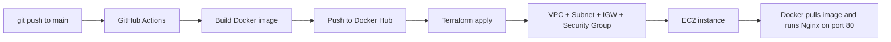

# AWS VPC + EC2 + Docker with Terraform and GitHub Actions

Deploy a Dockerized Nginx website to AWS automatically. One `git push` builds the Docker image, creates the AWS network and server with Terraform, and runs the container on EC2.

   

This is a beginner-friendly learning project. It is meant for testing and demos, not production.

## What it does



1. **Build:** GitHub Actions builds the image from `app/Dockerfile` and pushes it to Docker Hub. The tags are the commit SHA and `latest`.
2. **Provision:** Terraform creates a VPC, public subnet, internet gateway, route table, security group (HTTP only) and a `t3.micro` EC2 instance.
3. **Run:** The EC2 startup script (`terraform/user_data.sh`) installs Docker, pulls the image and starts the container on port 80.
4. **Result:** The app URL appears in the workflow run **Summary** and in the Terraform step output (`app_url`).

Every push changes the image tag, so Terraform replaces the EC2 instance and the new instance runs the new image. Expect a short downtime during each deploy.

## Project structure

```
.
├── .github/workflows/
│   ├── deploy.yml        # build image + terraform apply (push to main, or manual)
│   └── destroy.yml       # terraform destroy (manual only)
├── app/
│   ├── Dockerfile        # nginx:latest + custom index.html
│   └── index.html
├── terraform/
│   ├── versions.tf       # provider + S3 backend
│   ├── variables.tf
│   ├── main.tf           # VPC, subnet, IGW, route table, SG, EC2
│   ├── outputs.tf
│   └── user_data.sh      # installs Docker and runs the container
└── README.md
```

## Prerequisites

- An AWS account
- A GitHub account
- A Docker Hub account
- Git installed on your computer

## One-time setup

### 1. AWS: IAM user for GitHub Actions

1. Open **IAM → Users → Create user**. Any name works, for example `github-actions`. The name is only a label and is not used in the code.
2. Choose **Attach policies directly** and add `AmazonEC2FullAccess` and `AmazonS3FullAccess`. These are fine for learning, but use tighter permissions for real projects.
3. Open the user, go to **Security credentials → Create access key → Command Line Interface**.
4. Copy the **Access Key ID** and **Secret Access Key**. The secret is shown only once.

### 2. AWS: S3 bucket for Terraform state

GitHub Actions starts with a clean machine on every run, so Terraform needs a remote place to remember what it created.

**Using the console:**
1. Set the region (top right) to the one you will deploy to, for example **Asia Pacific (Sydney) `ap-southeast-2`**.
2. Open **S3 → Create bucket**.
3. Enter a globally unique name, for example `tfstate-yourname-2026`.
4. Leave **Block all public access** on, and set **Bucket Versioning** to **Enable**.
5. Click **Create bucket**.

**Or using the AWS CLI** (change the bucket name and region):
```bash
aws s3api create-bucket --bucket YOUR-UNIQUE-BUCKET --region ap-southeast-2 \
  --create-bucket-configuration LocationConstraint=ap-southeast-2

aws s3api put-bucket-versioning --bucket YOUR-UNIQUE-BUCKET \
  --versioning-configuration Status=Enabled
```

> The bucket must be in the same region that the workflows use.

### 3. Docker Hub access token

1. Log in to [hub.docker.com](https://hub.docker.com).
2. Go to **Account settings → Personal access tokens → Generate new token**.
3. Choose **Repo Read & Write** permission and copy the token.

The image repository must be **public**, because the EC2 instance pulls it without logging in.

### 4. GitHub repository secrets

Go to your repo, then **Settings → Secrets and variables → Actions → Secrets tab → New repository secret**. Add these five:

| Secret name | Value |
|---|---|
| `AWS_ACCESS_KEY_ID` | Access key ID from step 1 |
| `AWS_SECRET_ACCESS_KEY` | Secret access key from step 1 |
| `TF_STATE_BUCKET` | Bucket name from step 2 (name only, no `s3://`) |
| `DOCKERHUB_USERNAME` | Your Docker Hub username |
| `DOCKERHUB_TOKEN` | Token from step 3 |

Use **repository secrets**, not environment secrets or variables. The names must match exactly.

### 5. Set your region

The project uses `ap-southeast-2` (Sydney). If your bucket is in another region, change it in all three places:

| File | Setting |
|---|---|
| `.github/workflows/deploy.yml` | `AWS_REGION` |
| `.github/workflows/destroy.yml` | `AWS_REGION` |
| `terraform/variables.tf` | `aws_region` default |

Or change them all at once:
```bash
sed -i 's/ap-southeast-2/YOUR-REGION/g' .github/workflows/deploy.yml .github/workflows/destroy.yml terraform/variables.tf
```

### 6. Push the code

```bash
git init
git add .
git commit -m "first commit"
git branch -M main
git remote add origin https://github.com/YOUR-USERNAME/YOUR-REPO.git
git push -u origin main
```

## Deploy

The workflow runs automatically on every push to `main`. You can also start it by hand from **Actions → Build and Deploy → Run workflow**.

When both jobs show a green tick:

1. Open the run **Summary** and find **App URL**. You can also look for `app_url` at the end of the **Terraform apply** step, or copy the public IP from **EC2 → Instances**.
2. Open `http://<public-ip>` in your browser. Use `http://`, not `https://`.
3. If the page doesn't load, wait 1–2 minutes. Docker needs time to start after the instance boots.

## Update the website

Edit `app/index.html`, then push:
```bash
git add .
git commit -m "update page"
git push
```
The workflow rebuilds the image and replaces the EC2 instance. The public IP address changes on each deploy.

## Clean up (avoid AWS charges)

An EC2 instance is billed for as long as it exists. When you are done:

1. Go to **Actions → Destroy Infrastructure → Run workflow** (branch `main`).
2. Wait for the green tick.
3. In the AWS console, check that **EC2 → Instances** shows the instance as **Terminated**.
4. Optional: disable auto-deploy with **Actions → Build and Deploy → ⋯ → Disable workflow**, so a push can't re-create the servers.

Keep the S3 bucket and the GitHub secrets if you plan to deploy again. The bucket costs almost nothing. To delete it for good, run destroy first, then use **S3 → Empty → Delete**.

**Re-deploying later:** enable the workflow again and click **Run workflow**. Your code, secrets and Docker Hub account are all reused.

## Optional: GitHub CLI commands

If you have the [GitHub CLI](https://cli.github.com) installed and logged in (`gh auth login`):

```bash
gh workflow run deploy.yml      # deploy
gh workflow run destroy.yml     # destroy
gh run watch                    # follow progress
gh workflow disable deploy.yml  # stop auto-deploy
gh workflow enable deploy.yml   # turn it back on
```

## Troubleshooting

| Error | Cause and fix |
|---|---|
| `Invalid Value … The value cannot be empty or all whitespace` at `terraform init` | The `TF_STATE_BUCKET` secret is missing, misspelled or empty. Add it as a **repository secret**. |
| `StatusCode: 301 … requested bucket from "X", actual location "Y"` | The workflow region doesn't match the bucket's region. Make them the same (see "Set your region"). |
| `NoSuchBucket` | The bucket name in `TF_STATE_BUCKET` has a typo, or the bucket was never created. |
| `AccessDenied` or `UnauthorizedOperation` | The IAM user lacks EC2 or S3 permission. Attach `AmazonEC2FullAccess` and `AmazonS3FullAccess`. |
| `InvalidClientTokenId` or `SignatureDoesNotMatch` | The AWS key or secret was pasted incorrectly. Save both secrets again. |
| Build job fails at Docker login | Check `DOCKERHUB_USERNAME` and `DOCKERHUB_TOKEN`. The token needs **Read & Write**. |
| Site doesn't load | Wait 2 minutes, use `http://`, and make sure the Docker Hub image is public. For details, use **EC2 → Actions → Monitor and troubleshoot → Get system log**. |
| `InvalidAMIID.NotFound` | A hardcoded AMI ID is region-specific. Use the SSM lookup already in `main.tf` (`data.aws_ssm_parameter.al2023`). |

## Cost

Resources created: one `t3.micro` EC2 instance with a 10 GB disk and a public IPv4 address. The VPC, subnet, route table and security group are free. Prices vary, so check your AWS Billing page. Destroy the stack when you finish.

## Security notes

- Never commit AWS keys or tokens. This project keeps them in GitHub secrets only.
- Port 80 is open to the whole internet. SSH is not opened.
- The instance has no IAM role and no login method, so you can't connect to it. To inspect it, add AWS Systems Manager (SSM) Session Manager with an instance profile that has `AmazonSSMManagedInstanceCore`.
- Prefer GitHub OIDC over long-lived access keys for anything beyond learning.

## Ideas for next steps

- Use GitHub OIDC instead of access keys
- Add SSM Session Manager for browser-based access to the instance
- Push images to Amazon ECR instead of Docker Hub
- Add an Application Load Balancer and HTTPS
- Add `terraform plan` on pull requests and require approval before apply
- Add an Elastic IP so the address doesn't change

## License

MIT